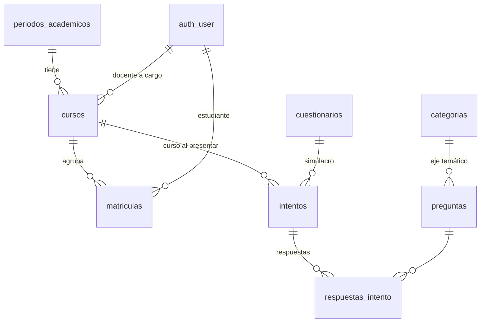

# Módulo de consultas, reportes y exportación a Excel

Pantalla: **Consultas y reportes** en el menú del administrador y del docente (`/reportes/consultas/`).

## 1. Modelo de datos y ruta hasta la calificación



| Filtro | Origen en la base de datos |
|---|---|
| Año | `periodos_academicos.anio` |
| Período | `periodos_academicos` (`anio`-`numero`, p. ej. 2026-2) |
| Curso / grupo | `cursos` (pertenece a un período; tiene docente a cargo) |
| Eje temático | `categorias`, a través de `respuestas_intento → preguntas` |
| Estudiante | `intentos.participante_codigo` = código institucional del estudiante matriculado |

**Ruta:** estudiante → `matriculas` → `cursos` → `periodos_academicos`. Al iniciar un intento se guarda en `intentos.curso_id` el curso vigente del estudiante (período que incluye la fecha). Así un reporte histórico no cambia si después lo matriculan en otro curso. Para intentos anteriores al módulo: `python manage.py asignar_cursos_intentos`.

Cada intento tiene estudiante (`participante_codigo`, `participante_nombre`), evaluación (`cuestionario_id`), fecha (`fecha_inicio`, `fecha_fin`), estado (`en_progreso`, `finalizado`, `vencido`) y calificación.

**Fórmula de la nota** (al entregar):

```
calificacion = puntaje_obtenido / puntaje_total_posible × calificacion_maxima
nota sobre 5,0 = calificacion × 5 / calificacion_maxima
aprobado = calificacion ≥ calificacion_aprobacion del simulacro
```

## 2. Reglas de cálculo

- **Escala:** todas las notas se muestran y exportan sobre 5,0, con dos decimales.
- **Umbral de aprobación:** el de cada simulacro. La pantalla lo muestra junto a los indicadores.
- **Intentos que cuentan:** promedio, mínima, máxima y aprobación usan solo intentos **terminados** (finalizados o vencidos, con nota). Los intentos en progreso se listan, pero no cuentan; la pantalla indica cuántos hay.
- **Estudiantes e intentos:** se cuentan por separado. "Estudiantes evaluados" son códigos distintos; un estudiante puede tener varios intentos.
- **Por eje:** se cuentan las respuestas contestadas (aciertos, errores y porcentaje). No se calcula nota por eje, porque el sistema no define una regla para convertir aciertos en calificación.
- **Los reportes no modifican datos.** Solo leen con el ORM.

## 3. Filtros jerárquicos

AÑO → PERÍODO → CURSO → EJE → ESTUDIANTE, cada uno con la opción "Todos".

- En la pantalla, cada lista solo ofrece valores compatibles con la anterior. Al cambiar un filtro padre, se limpia la selección hija que dejó de ser válida.
- El servidor repite la validación: un valor incompatible se quita y se avisa.
- "Limpiar filtros" vuelve a la consulta general.
- La tabla de calificaciones se pagina de 10 en 10, se ordena por fecha, nombre o nota (de mayor a menor) y conserva los filtros entre páginas.

## 4. Consultas y archivos Excel

| N.º | Consulta | Dónde |
|---|---|---|
| 1 | Consolidado general | Indicadores superiores |
| 2 | Resultados por año y período | Pestaña "Por período" |
| 3 | Resultados por curso | Pestaña "Por curso" |
| 4 | Desempeño por eje temático | Pestaña "Por eje temático" |
| 5 | Calificaciones por estudiante | Pestaña "Calificaciones" |
| 6 | Historial individual (con evolución) | Pestaña "Historial individual" |
| 7 | Preguntas de mayor dificultad | Pestaña "Preguntas difíciles" |

| Excel | Contenido |
|---|---|
| A · Consolidado | Año, período, curso, estudiante, identificación, simulacro, fecha, calificación y estado. Hoja adicional con el promedio por estudiante |
| B · Por eje | Año, período, curso, eje, respuestas registradas, contestadas, aciertos, errores, sin responder, % de aciertos y nota promedio ("No definida") |
| C · Historial | Estudiante, curso, período, simulacro, fecha, respondidas, aciertos, errores y nota final. Un intento por fila, en orden cronológico |

Cada archivo:
- incluye el nombre del reporte, la fecha de generación, los filtros activos y las reglas de cálculo;
- tiene un nombre descriptivo, por ejemplo `reporte_consolidado_2026-2_sexto-a_20261105-1030.xlsx`;
- contiene **todos** los registros filtrados, no solo la página visible.

Sin registros, se descarga igual con los encabezados y el aviso "Sin registros para los filtros aplicados.".

## 5. Seguridad

- La vista y la exportación exigen sesión y el permiso `resultados.consultar_todos`. Los estudiantes reciben 403.
- **Administrador:** ve todos los cursos.
- **Docente:** solo ve los cursos que tiene a cargo (`cursos.docente_id`). Si pide en la URL un curso o período ajeno, el servidor responde **403**, tanto en la pantalla como en el Excel.
- El estudiante solo ve sus propios resultados en su panel.

## 6. Datos de prueba y demostración

```bash
python manage.py datos_demo_consultas            # 3 períodos, 5 cursos, 12 estudiantes, ~90 intentos
python manage.py datos_demo_consultas --limpiar  # borra solo esos datos
```

- Los cursos "A" quedan a cargo del primer docente activo.
- Períodos, cursos y matrículas se administran en `/admin/` → *Estructura académica*.
- Pruebas automáticas: `apps/reportes/tests/test_consultas.py` y `pruebas_e2e/test_consultas.py`.
